<div align="center">

<picture>
  <source media="(prefers-color-scheme: dark)" srcset="public/logo-dark.svg">
  
</picture>

# Growth <sub>by Setups Works</sub>

**Analytics and WhatsApp campaigns for WooCommerce** — a product of
[Setups Works](https://setups.works).

Know who your best customers are, which ones are about to leave, and what they
buy — then message them on WhatsApp from the same screen, from your own number linked
by scanning a QR code.

<p>
  
  
  
  
  
</p>

</div>

---

## What this is

WooCommerce tells you what sold. Setups Works Growth tells you **who bought it, which
of them is slipping away, what they buy together, which products are about to
run out, and what next month looks like** — and then lets you act on it.

It is a self-hosted Next.js app. You authorize a store through WooCommerce's own
app-authorization endpoint, it pulls your orders over the REST API, caches a
snapshot, and derives every metric from that snapshot at request time. WhatsApp
sending goes through your own linked number, from a service in the same
deployment, so customer numbers never reach a third-party messaging service.

> **There is no sample data anywhere in this codebase.** Every number you see
> came from your store. A figure can never be a placeholder you mistook for real.

---

## Table of contents

- [Feature list](#feature-list)
- [Complete feature list](#complete-feature-list)
- [Feature tour](#feature-tour)
- [Keyboard shortcuts](#keyboard-shortcuts)
- [Small things](#small-things)
- [Architecture](#architecture)
- [Data pipeline](#data-pipeline)
- [Broadcast pipeline](#broadcast-pipeline)
- [Flow pipeline](#flow-pipeline)
- [Assistant pipeline](#assistant-pipeline)
- [Inbound pipeline](#inbound-pipeline)
- [Quick start](#quick-start)
- [Connecting a store](#connecting-a-store)
- [WhatsApp campaigns](#whatsapp-campaigns)
- [Automated flows](#automated-flows)
- [Abandoned checkout recovery](#abandoned-checkout-recovery)
- [The menu bot](#the-menu-bot)
- [The assistant](#the-assistant)
- [Multiple stores](#multiple-stores)
- [Accounts and sign-in](#accounts-and-sign-in)
- [Environment variables](#environment-variables)
- [Reports and exports](#reports-and-exports)
- [How the metrics are defined](#how-the-metrics-are-defined)
- [Performance](#performance)
- [Design system](#design-system)
- [Deployment](#deployment)
- [Troubleshooting](#troubleshooting)
- [Scripts](#scripts)

---

## Feature list

<details open>
<summary><b>Revenue &amp; performance</b></summary>

- Net revenue, gross revenue, orders, average order value, units sold
- Discounts given, shipping collected, tax collected, refunded amount
- Items per order, revenue per customer, cancellation rate
- Every KPI compared against the **equal-length previous window**
- Revenue and orders on one shared axis (no misleading dual-axis charts)
- Day / week / month bucketing, automatic or manual
- Sparkline trend on each headline stat
- Refund rate, cancellation rate and average fulfilment time
- Generated findings, ranked by urgency, in plain English

</details>

<details open>
<summary><b>Customer analytics</b></summary>

- **RFM scoring** — recency, frequency and monetary quintiles of your own base
- **Ten standard RFM segments** — Champions, Loyal, Potential Loyalist, New
  Customers, Promising, Need Attention, At Risk, Cannot Lose Them, Hibernating,
  Lost
- **Value tiers** — VIP, High, Mid, Low, One-time
- **Predicted lifetime value** per customer, discounted by churn risk
- **Churn risk score**, judged against each customer's own reorder cadence
- **Revenue deciles** with a Pareto curve and cumulative share
- **Gini concentration coefficient**, top 1/5/10/20% and bottom 50% shares
- Recency-versus-frequency bubble chart, sized by spend
- **Top customer spotlight** with their orders inline
- Ready-made cohorts: **high value, low value, at risk, rising**
- **Advanced filters** — segment, tier, spend, orders, churn risk, recency,
  country, product bought, contactability
- **Every customer listed**, not a capped slice, rows expand in place
- Average days between orders, one-time buyer share, repeat rate

</details>

<details open>
<summary><b>Customer profiles</b></summary>

- Any customer row anywhere drills through to their profile
- Identity, location, payment method, how long they have been a customer
- **Acquisition channel and device** they arrived on
- RFM scores as filled pips as well as numbers, so never colour-only
- Revenue percentile, refunds taken, discounts used
- What they buy, ranked by revenue
- Order value over time
- **Full order history** with status, line items, units, total and net

</details>

<details open>
<summary><b>Acquisition &amp; retention</b></summary>

- **New vs returning revenue** by month, stacked
- **Full new- and returning-customer tables**, sortable and searchable
- **Acquisition channels** from WooCommerce Order Attribution
- Which channels bring **first-time** buyers, not just orders
- **Device breakdown** by revenue and AOV
- Pages per session and revenue per customer, per channel
- **Median time to second order**, with quartiles and a histogram
- **Cohort retention triangle**, unelapsed cells blank rather than zero
- **Cumulative LTV curve** per acquired customer
- Attribution coverage percentage, so partial history is never hidden

</details>

<details open>
<summary><b>Campaigns &amp; audiences</b></summary>

- **Audience builder** with live reach, revenue, predicted CLV and churn risk
- **Goal presets** — VIP appreciation, win-back lapsed, convert to second order,
  rescue at-risk high value, loyal advocates, business accounts
- Filter on segment, tier, recency, spend, orders, churn risk, country, account
  type, product bought, contactability
- Live audience preview, exactly matching the export
- **CSV export** shaped for email and ads platforms, formula-injection guarded
- **Campaign performance** from `utm_campaign`
- **Coupon performance** — uses, discount given, revenue, return on discount

</details>

<details open>
<summary><b>WhatsApp campaigns</b></summary>

- Send **text, image or video** from **your own number**, linked by QR like WhatsApp Web
- **Ten templates**: announce one product, reorder their product, new in a category they buy, win
  back a lapsed customer, nudge a one-time buyer, thank a VIP, ask for a review,
  coupon + their product, coupon only, plain announcement
- **Per-customer variables** — `{{name}}`, `{{product}}`, `{{product_url}}`,
  `{{category}}`, `{{last_order}}`, `{{orders}}`, `{{spend}}`, `{{store}}`,
  `{{coupon}}`, `{{coupon_value}}`
- **Per-customer product photos** — each recipient sees what *they* buy
- **Product picker** — search the catalogue by name, SKU or category and send
  everyone one specific product instead
- **Coupons** — pick an existing WooCommerce coupon, or generate one with an
  expiry, one use per customer, and a restriction to the campaign product
- **Dry run** resolving the real recipient list and sending nothing
- **Test send** to a number you type; it cannot reach a customer
- **Typed confirmation** of the deliverable count before anything goes out
- **Opt-out list**, applied server-side after the audience is built
- **Multi-step flows** — up to ten messages, days apart, advanced by a scheduled
  job; customers join as they qualify and leave the moment they order
- **Flow test mode** — point a whole sequence at one number so it can never
  reach a customer
- **A built-in inbound menu bot** that answers when
  nobody is at a desk
- **Menu builder** at `/menu` — trigger word, greeting and a drag-and-drop option
  tree, with every move also on a button so it works without a mouse
- **An assistant** that reads the store, drafts messages against your real
  catalogue, and proposes rather than performs
- **Per-page summaries** in plain English, on request
- **Paced sending** with jitter, as a resumable job with live progress
- **Automatic recovery** when the WhatsApp engine restarts mid-broadcast
- Link a number by scanning a **QR inside Settings**

</details>

<details open>
<summary><b>WhatsApp inbox</b></summary>

- Conversations with **the customer behind each number**, not raw identifiers
- Orders and lifetime spend beside every conversation
- Link straight through to that customer's full profile
- Thread view that **polls for replies** while open
- Composer for text, media, or a product from your catalogue
- **Start a conversation from a typed number**, without waiting to be messaged
- Unread counts, and search across names and numbers
- Opt-out list applies to one-to-one replies too

</details>

<details open>
<summary><b>Inventory &amp; restock planning</b></summary>

- **Days of cover** per SKU from stock and observed velocity
- **Reorder point** from a stated lead time plus safety stock
- **Suggested order quantity** to reach healthy cover
- Status per SKU: out of stock, critical, low, healthy, overstocked, untracked
- **Revenue at risk** if a critical SKU stays out for one lead time
- **Capital tied up** per SKU, to surface overstock
- Restock planner with reorder / all / overstocked views
- **CSV export** shaped as a draft purchase order

</details>

<details open>
<summary><b>Product &amp; catalogue analytics</b></summary>

- **ABC classification** — A carries the first 80% of revenue, B the next 15%
- Pareto concentration chart with the 80% threshold marked
- Revenue, units, orders, distinct customers, average price per SKU
- Units-per-day velocity, refund rate per SKU, average rating
- **Market-basket affinity** by support, confidence and lift
- Category revenue and unit mix
- Best sellers by value and volume; slow movers and never-sold items

</details>

<details open>
<summary><b>Orders &amp; operations</b></summary>

- Full order register with totals, discount, shipping, tax, refunds, payment
  method and coupons
- New vs returning flag per order
- **Order status mix** and basket-size distribution
- **Payment method** performance by revenue, share and AOV
- **Trading heatmap** — day of week × hour of day
- Weekday revenue performance
- Fulfilment time, completion share, cancellation and refund rates

</details>

<details open>
<summary><b>Forecasting &amp; geography</b></summary>

- Daily revenue projection from OLS trend × day-of-week seasonality
- **95% confidence band** from in-sample residuals
- Implied pace versus the recent actual run rate
- Revenue, orders, customers and AOV by **country**, **region** and **city**

</details>

<details open>
<summary><b>Search &amp; navigation</b></summary>

- **Command palette** over customers, products and orders
- Filtering runs before rendering, so tens of thousands stay fast
- Jump to any page, change the date range, re-sync or switch theme from it
- **Keyboard shortcuts** throughout, with a `?` help sheet
- Shortcuts ignored while typing, so they never eat a search query
- Collapsible sidebar; date range and granularity persisted across reloads

</details>

<details open>
<summary><b>Multiple stores</b></summary>

- Connect **several stores** and switch between them
- Switcher in the sidebar; full management in Settings
- Each keeps its **own credentials, data window and snapshot cache**
- Re-authorizing updates a key in place rather than duplicating the store

</details>

<details open>
<summary><b>Reports &amp; exports</b></summary>

- **Ten report types** — executive summary, customer ledger, segmentation,
  products, categories, order register, cohorts, geography, operations, forecast
- **Excel** — one sheet per report, cover page, auto-filters, frozen headers,
  per-cell currency formats
- **PDF** — branded cover with KPI cards and findings, embedded Unicode font so
  every currency symbol renders
- **CSV** — BOM-prefixed, formula-injection guarded, spreadsheet-parseable
- **Presets** — board pack, CRM upload, merchandising review, finance
  reconciliation, complete export
- Exports match the on-screen date range and are never row-capped
- **Written report view** at `/reports/view` — conclusion first, method last

</details>

<details open>
<summary><b>Connection &amp; security</b></summary>

- **WooCommerce app authorization** — approve access in your own WordPress admin
- **No form or environment variable accepts a WooCommerce consumer key**
- HMAC-signed, self-contained state token binds the browser redirect to the
  server-to-server callback, so the two legs may land on different instances
- Credentials verified against the store before being persisted
- Everything durable lives in PostgreSQL — one container, one volume
- Preflight rejects non-HTTPS and non-routable callbacks **before** you approve
- Email + password accounts (scrypt hashes), HMAC-SHA256 session cookies verified in Proxy
- Rate-limited sign-in and one-time, hashed password-reset links
- One-click disconnect wipes the key and every cached order
- **Customer phone numbers never reach the browser** — the payload carries only
  whether someone is reachable
- The WhatsApp engine key never leaves the server; the engine is unreachable from outside Docker

</details>

---

## Complete feature list

Everything in the product, so nothing shipped is undocumented.

<details>
<summary><b>Analytics</b></summary>

**Revenue** — net and gross revenue · orders · average order value · units ·
discounts · shipping · tax · refunds · items per order · revenue per customer ·
cancellation rate · period-on-period comparison · day, week and month views ·
sparkline trends · generated findings ranked by urgency

**Customers** — RFM scoring · ten segments · five value tiers · predicted
lifetime value · churn risk · revenue deciles · Pareto curve · Gini coefficient ·
recency-frequency plot · top-customer spotlight · high value, low value, at risk
and rising cohorts · full ledger with expandable orders

**Profiles** — contact details · location · acquisition channel and device · RFM
pips · revenue percentile · refunds · discounts used · products ranked by revenue
· order value over time · complete order history

**Acquisition** — new versus returning revenue · full customer tables · channel
attribution · first-time buyer analysis per channel · device breakdown · pages
per session · time to second order with quartiles · monthly cohort retention ·
cumulative LTV curve · attribution coverage

**Products** — ABC classification · Pareto concentration · revenue, units, orders
and distinct customers per product · price and velocity · refund rate per product
· average rating · market-basket affinity by lift · category mix · best sellers
by value and volume · slow movers · never-sold items

**Inventory** — days of cover · reorder points from lead time · suggested order
quantities · out of stock, critical, low, healthy and overstocked states · revenue
at risk · capital tied up · restock planner · draft purchase order export

**Operations** — full order register · status mix · basket-size distribution ·
payment method performance · day-by-hour trading heatmap · weekday performance ·
fulfilment timing

**Forecast and geography** — daily revenue projection · 95% confidence band ·
weekday seasonality shown explicitly · revenue, orders, customers and AOV by
country, state and city

</details>

<details>
<summary><b>Messaging</b></summary>

**Campaigns** — audience builder with live reach · six goal presets · filters on
segment, tier, recency, spend, orders, churn risk, country, account type, product
bought and contactability · revenue and predicted value at stake · CSV export for
email and ads platforms · campaign performance from UTM tags · coupon return on
discount

**WhatsApp** — text, image and video · nine templates · eleven personalisation
variables · per-customer product photos · catalogue product picker · coupon
creation and attachment · dry run · test send · typed confirmation · opt-out list
· paced sending with jitter · resumable jobs · automatic reconnect after restarts · live
progress and stop control

**Inbox** — conversations matched to customers · order count and lifetime spend
beside each · link to full profile · live reply polling · text, media and product
replies · start a conversation from a number · unread counts · search across names
and numbers · opt-out enforced

</details>

<details>
<summary><b>Platform</b></summary>

**Reports** — ten report types · Excel with formatted sheets, filters and currency
formats · PDF with cover, KPIs and findings · CSV for pipelines · board pack, CRM
upload, merchandising and finance presets · written report view · exports match
the on-screen range and are never truncated

**Interface** — multiple stores with instant switching · command palette across
customers, products and orders · keyboard navigation throughout · light and dark
themes · persisted date ranges · sortable, searchable, expandable tables ·
optional password protection · honest empty states · partial-data warnings

**Security** — approval inside your own WordPress admin · no consumer key ever
typed into a form · verification before saving · keys shown masked · phone numbers
never sent to the browser · opt-outs enforced server-side · one-click disconnect
wipes the key and every cached order

</details>

---

## Feature tour

### Dashboard
Headline KPIs against the equal-length previous window, revenue and orders on a
single shared axis, findings ordered by urgency, top products and customers,
payment mix, geography, and a day × hour trading heatmap.

### Customers
RFM scoring mapped to ten segments, value tiers, predicted CLV, churn risk, and
a Pareto view with a Gini coefficient. Top-customer spotlight, advanced filters,
and the complete ledger with orders expandable in place.

### Acquisition and cohorts
New versus returning revenue by month with full tables of each. Channel and
device breakdowns from Order Attribution, median time to a second order, a
retention triangle and a cumulative LTV curve.

### Campaigns
Build an audience, choose a template, attach a coupon and a product, dry-run it,
test it, then send. Plus campaign performance from `utm_campaign` and coupon
return-on-discount.

### Inbox
WhatsApp conversations with the customer behind each number, their order count
and spend alongside, and a composer that sends text, media or a catalogue
product.

### Inventory
Days of cover, reorder points, suggested quantities, revenue at risk and capital
tied up, with a CSV export shaped as a draft purchase order.

### Products, orders and forecast
ABC classification and market-basket affinity; the full order register with
payment and coupon performance; a projection with a 95% band.

---

## Keyboard shortcuts

| Key | Action |
|---|---|
| `⌘K` / `Ctrl K` | Open search and commands |
| `/` | Open search |
| `?` | Show the shortcut list |
| `⌘⇧R` | Re-sync from WooCommerce |
| `⌘⇧L` | Toggle light and dark |
| `g` `d` | Dashboard |
| `g` `f` | Forecast |
| `g` `c` | Customers |
| `g` `a` | Acquisition |
| `g` `h` | Cohorts and retention |
| `g` `p` | Products |
| `g` `i` | Inventory |
| `g` `o` | Orders |
| `g` `m` | Campaigns |
| `g` `w` | Inbox |
| `g` `r` | Reports |
| `g` `s` | Settings |

All shortcuts are ignored while you are typing into a field.

---
## Small things

The details that do not fit a feature list but decide whether the thing is
pleasant to use.

**Interface**

- Date range and granularity persist across reloads, read through an external
  store rather than restored in an effect — so there is no flash of the wrong
  range on first paint
- Tables sort, search, paginate, keep a sticky first column, and expand rows in
  place rather than navigating away
- Tabular figures in every column that has to align; proportional elsewhere
- Empty states explain *why* a section is empty rather than showing zero
- Partial-history and truncated-pull warnings are surfaced, never hidden
- Sidebar collapses; the layout is usable from 375px up
- Light and dark are both designed, not auto-inverted

**Search and keyboard**

- The command palette filters data *before* rendering, so 11,000 customers do
  not mount 11,000 nodes to hide most of them
- Shortcuts are ignored inside inputs, textareas, selects and open comboboxes,
  so typing a search query never triggers navigation
- `g` chords lapse after 1.2 seconds, so a stray `g` does not arm forever
- `?` and `shift+/` both open the help sheet, because keyboard layouts disagree

**Exports**

- CSV is BOM-prefixed so Excel opens UTF-8 correctly
- Formula injection is guarded on text only — an earlier version turned every
  negative number into a string because `-` matched the guard
- Dates export as `yyyy-mm-dd`, parseable by every spreadsheet
- PDFs embed Geist, because the standard PDF encoding has no `₹` glyph and
  silently substituted a superscript one
- Exports follow the on-screen date range, so a download can never disagree with
  the dashboard it came from

**Correctness**

- Cohort cells that have not elapsed are blank, not zero
- New and returning customer lists deliberately overlap; the alternative made
  the returning list empty on any full-history range
- Product names, categories and customer names are HTML-decoded once at ingest,
  so no chart, table, PDF or CSV has to think about it
- Money is formatted from the store's own currency, not a hard-coded symbol

**Safety**

- Secrets are masked everywhere they are displayed and never returned to the
  browser after being saved
- The WhatsApp test send cannot reach a customer — it only accepts a typed number
- Generated coupon codes omit `O`, `0`, `I` and `1`
- Duplicate phone numbers across customer records collapse to one recipient
- Every skipped recipient is counted and categorised, so "sent 9,800 of 11,000"
  always has an explanation

---

## Architecture

Four systems. Three run on infrastructure you control; the fourth is a model
provider that never sees a customer.

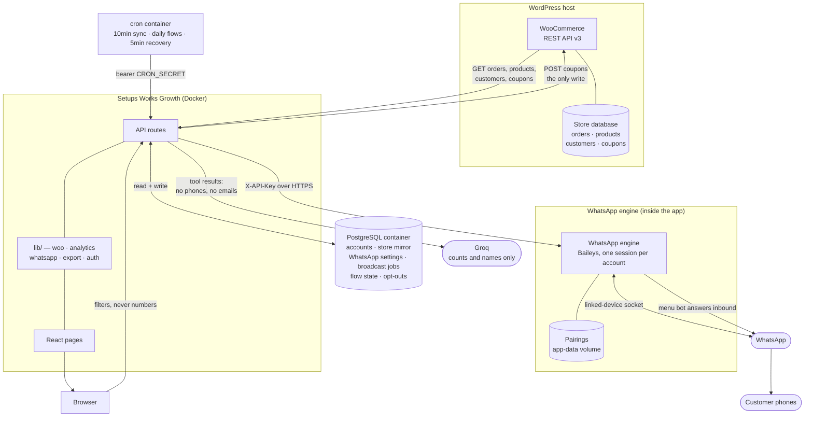

Two properties hold by construction rather than by care:

- **The web app never speaks to WhatsApp.** It speaks to the WhatsApp engine
  over the private Docker network; the engine holds each account's socket.
- **The browser never receives a phone number.** The analytics payload carries a
  `hasPhone` boolean. Numbers are resolved server-side at send time.
- **The model never receives one either.** Its tools return counts, names and
  keys; a customer is addressed by key and the number is resolved at send time,
  so nothing it can read could appear in something it writes.
- **Nothing waits in a request.** A broadcast paces itself over hours and a flow
  over days. Both keep their position in storage and are advanced by ticks — one
  driven by the browser, one by cron.

### Inside the app

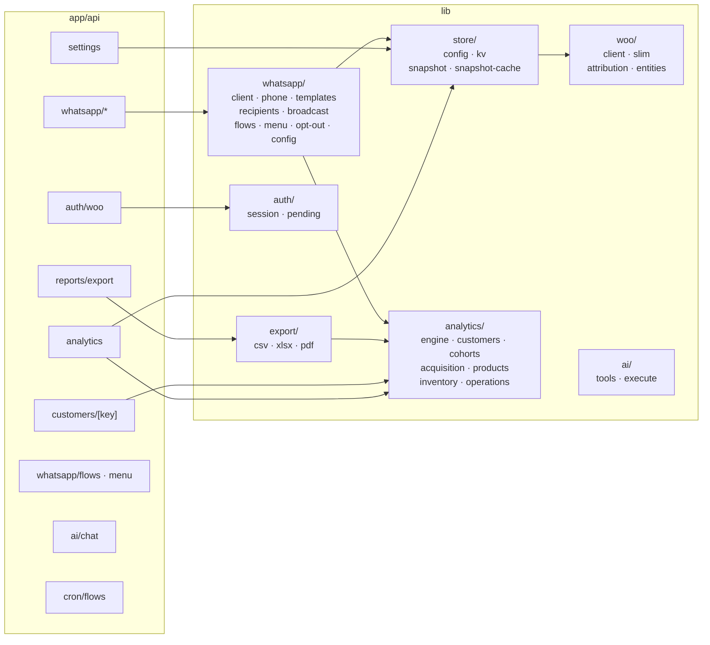

`analytics/` is pure: functions from a snapshot to numbers, with no I/O. That is
what makes a date-range change cost milliseconds and makes every figure
reproducible from the same input.

### Layout

```
src/
├── app/
│   ├── page.tsx              Authorization page (the root)
│   ├── (app)/                Pages behind the sidebar shell
│   │   ├── dashboard/        Headline KPIs, trend, findings
│   │   ├── customers/        RFM, tiers, CLV, churn, [key] profiles
│   │   ├── acquisition/      New vs returning, channels, devices
│   │   ├── cohorts/          Retention triangle, LTV curve
│   │   ├── campaigns/        Audience builder + WhatsApp send panel
│   │   ├── inbox/            WhatsApp conversations
│   │   ├── products/         ABC, refund rate, affinity
│   │   ├── inventory/        Restock planner, reorder points
│   │   ├── orders/           Register, payments, coupons
│   │   ├── forecast/         Trend + seasonality projection
│   │   ├── reports/          Report builder and written report
│   │   └── settings/         Stores, WhatsApp, data window
│   └── api/
│       ├── analytics/        Computes the full payload
│       ├── customers/[key]/  One customer with order history, on demand
│       ├── auth/woo/         start → callback → return
│       ├── reports/          Export generation
│       ├── settings/         Connection state, switching, data window
│       └── whatsapp/
│           ├── settings/     WhatsApp link state and preferences
│           ├── session/      Session state and pairing QR
│           ├── preview/      Dry run — resolves recipients, sends nothing
│           ├── test/         One message to a typed number
│           ├── broadcast/    Create, tick, cancel
│           ├── chats/        Conversations and replies
│           ├── products/     Catalogue search
│           ├── coupons/      List, and the one write in the app
│           └── opt-out/      Numbers excluded from every send
├── lib/
│   ├── woo/                  REST client, field trimming, slimming, attribution
│   ├── store/                Config, KV abstraction, snapshot cache
│   ├── analytics/            Pure engine: KPIs, customers, cohorts, acquisition,
│   │                         products, inventory, operations, forecast
│   ├── whatsapp/             Engine client, phone normalisation, templates,
│   │                         recipient resolution, broadcast jobs, opt-outs
│   ├── export/               CSV, Excel and PDF builders, embedded fonts
│   └── auth/                 Signed sessions, signed authorization state
├── components/
│   ├── charts/               Chart primitives on a CVD-validated palette
│   ├── dashboard/            Stat strip, data table, filters, page states
│   ├── layout/               Sidebar, topbar, store switcher, command palette
│   ├── whatsapp/             WhatsApp settings, QR, send panel, product picker
│   └── ui/                   shadcn/ui
└── middleware.ts             Session gate
```

### Scope

The store key is `read_write`, for exactly one reason: creating campaign
coupons. WooCommerce offers no finer scope, so the narrowing is enforced in
code — `WooClient` has one mutating method, `createCoupon`, reached by one
endpoint. Nothing writes to orders, products, customers or settings. Set the
scope back to `read` in `api/auth/woo/start` and re-authorize if you do not want
generated coupons; every other feature is unaffected.

---

## Data pipeline

One sync into PostgreSQL, a short in-memory memo, then everything derived from it.

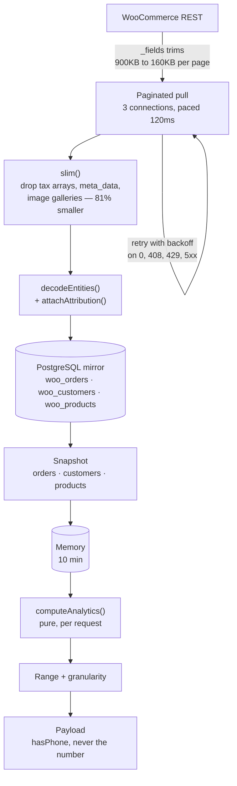

### Cache lookup order

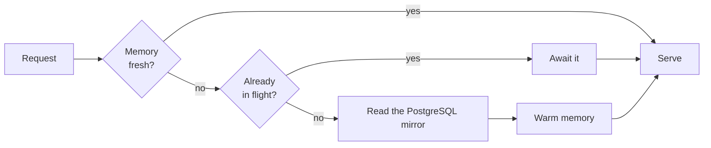

**Why a snapshot.** Every metric — RFM, cohorts, affinity, forecast — needs the
whole order history, not a page of it. Computing from one cached snapshot means
a filter change costs milliseconds instead of a re-pull.

**Why in-flight collapsing.** A single page load fires several requests. Without
it, a cold start would begin several identical multi-minute pulls at once.

**Where freshness comes from.** The `cron` container syncs every connected store
every 10 minutes, and a sync drops the in-memory memo the moment new data lands.

---

## Broadcast pipeline

A broadcast is a resumable job, not a long request.

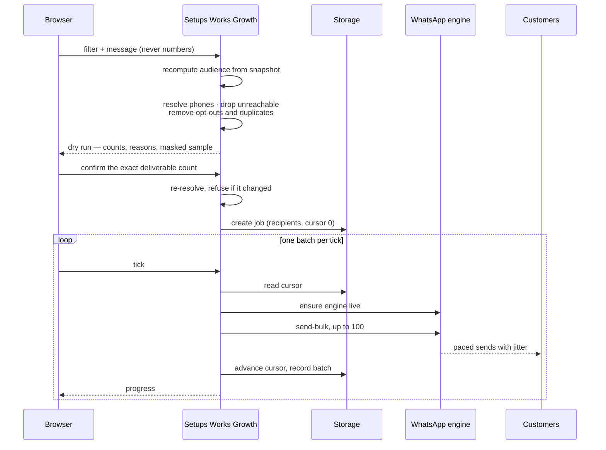

### Job states

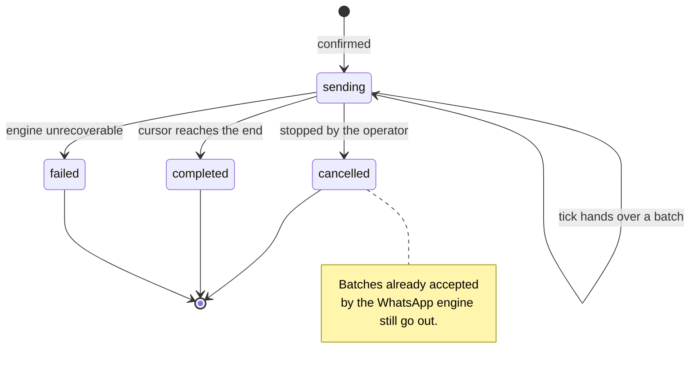

### WhatsApp session states

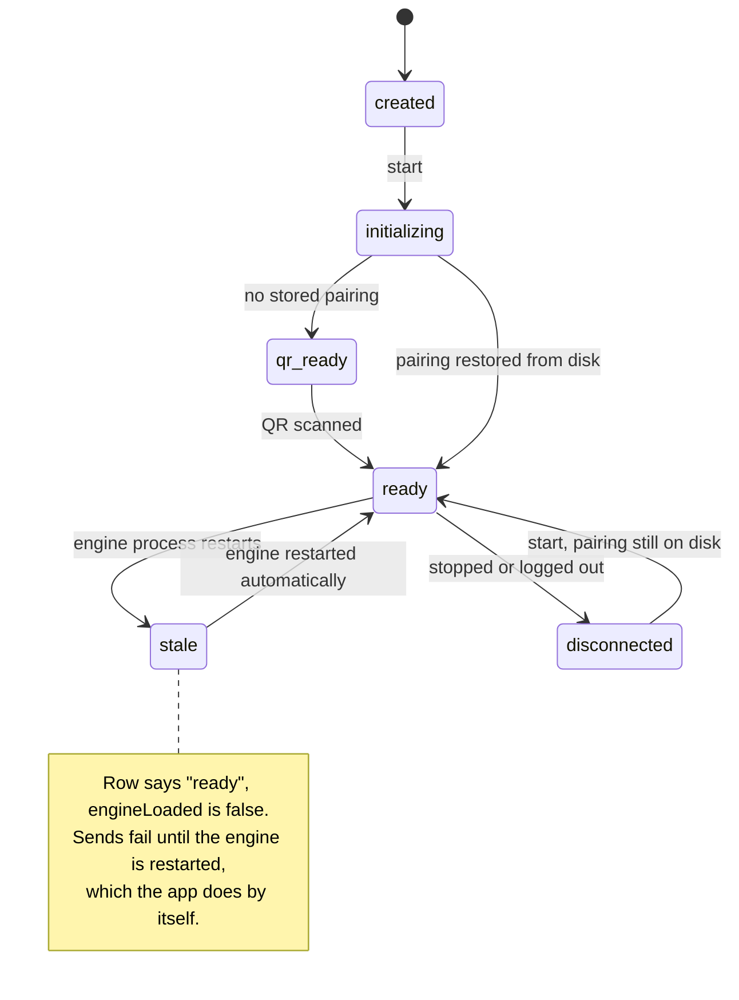

**Why ticks.** The WhatsApp engine paces its own batches — a hundred recipients at four
seconds apart occupies it for roughly seven minutes — which no HTTP
request can wait out. Each tick hands over at most one batch and returns, so
closing the page pauses the job rather than breaking it, and whatever was
already handed over still goes out.

**Why recipients are resolved on the server.** The browser sends a *filter*.
Numbers are derived from the snapshot at send time, so no crafted request can
address someone who is not a customer of the connected store, and the opt-out
list cannot be routed around by the UI.

**Why both readiness signals are checked.** `status` is a persisted database
value and `engineLoaded` is the live one. After an engine restart the row still
says `ready` while the engine is gone, and a send in that state fails for every
recipient. Both must agree before anything is dispatched.

---
## Flow pipeline

A broadcast is one message now. A flow waits days between steps, which no
HTTP request can sit through — so the waiting lives in storage and a
scheduled job advances it.

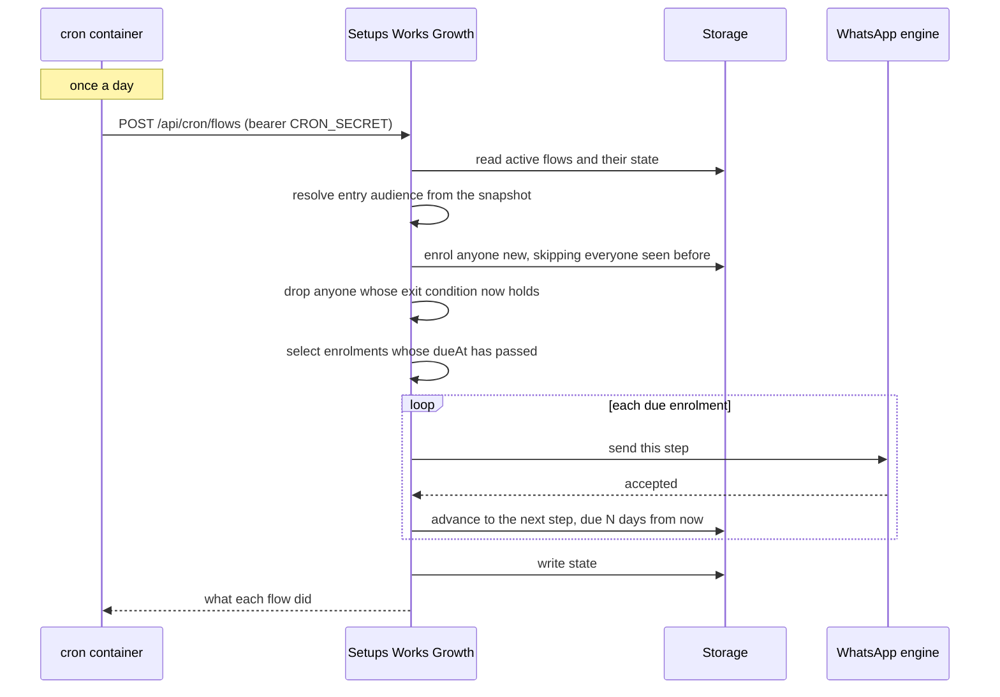

**Time, not wakefulness, decides what sends.** Every due date is stored. A tick
that is skipped, retried or runs late therefore sends the same messages, once,
whenever it does run — a missed run delays a step rather than losing it, and an
enrolment advances only after its send returns, so it cannot double one.

**Each wait is measured from the send, not from enrolment.** If a run is four
days late, step two is still three days after step one *went out*, not three days
after the customer joined. Measuring from enrolment would fire two messages
within seconds to catch up. There is a test for exactly this.

**The tick is bounded.** At most 500 enrolments and 60 sends per run, 5,000 in
flight per flow. Whatever is left is picked up next time: a flow that enrols
slowly is correct, just slower, whereas a tick that times out mid-send leaves
state nobody can reason about.

**The cron route is closed when its secret is unset.** `CRON_SECRET` missing
returns 503 rather than running open — the failure mode of a missing environment
variable must never be "anyone on the internet can trigger the sends".

---

## Assistant pipeline

The loop is the safety model. Reads run; actions stop and wait for a person.

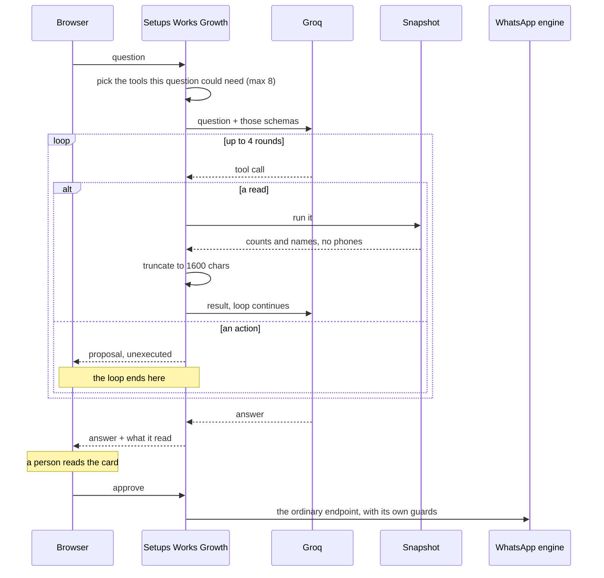

**The model holds no power of its own.** An action tool is never executed
server-side. It comes back as a card, and approving it calls the same REST
endpoint the matching screen calls — so the assistant is a route to those
endpoints, not a way around the checks they already have.

**A proposal ends the turn even if reads were requested alongside it.** Running
them and looping would let the model revise or withdraw its own proposal before
anyone saw it, and the point is that a person sees exactly what was proposed.

**Invented URLs are stripped, not merely discouraged.** Any `imageUrl` or
`productUrl` absent from this turn's tool results is removed before the proposal
is shown, and the removal is stated on the card. Told plainly not to invent a
link, a smaller model still proposed `https://example.com/…` without calling the
catalogue at all — a prompt is a request, this is a rule.

**Three things keep a question inside a metered budget:** only relevant tools are
sent, results are truncated with the truncation announced, and optional
parameters accept `null` (widened via `type`, never `anyOf` — unions made the
model fail to produce a call at all).

---

## Inbound pipeline

Everything else here reaches out. This is the one path that starts with the
customer, and it does not run in this application at all.

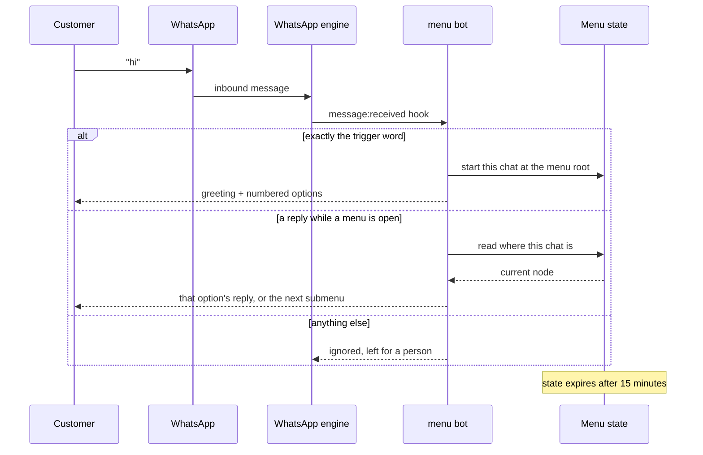

**It runs in the WhatsApp engine**, which is why it answers at three in the
morning whether or not anyone has the app open.

**The trigger is matched exactly** — `input.toLowerCase() === trigger` — so `hi`
opens the menu while `this` and `hi there` do not. Left empty it matches *any*
text message, which on a live business line means every customer gets a menu
instead of a person; the editor warns rather than quietly accepting it.

**State expires after fifteen minutes**, so a stray `1` the next day is never
read as a menu choice.

---

## Quick start

Everything runs in Docker: the app, PostgreSQL, and a tiny scheduler.

```bash
git clone <your-repo-url> growth
cd growth
cp .env.example .env
# set POSTGRES_PASSWORD, AUTH_SECRET and CRON_SECRET
# (each: openssl rand -hex 32)
docker compose up -d --build
```

Open <http://localhost:3000>, create an account, and connect a store. Database
migrations run automatically when the app container starts.

| Service | What it is | Size |
|---|---|---|
| `app` | Next.js standalone server (Node 22 Alpine) | ~350 MB image |
| `db` | PostgreSQL 17 Alpine, data in the `db-data` volume | — |
| `cron` | BusyBox `crond` calling `/api/cron/*` | ~14 MB image |
| `caddy` | optional, automatic HTTPS (`--profile https`) | — |

**Requirements:** Docker with Compose v2, and a WooCommerce store with the REST
API enabled. WordPress permalinks must not be "Plain", or the REST API returns 404.

---

## Connecting a store

Connection uses **WooCommerce's own app authorization endpoint**
(`/wc-auth/v1/authorize`). You approve access inside your own WordPress admin;
WooCommerce issues the key and delivers it to this app.

There is deliberately **no form that accepts a consumer key**, and no
environment variable for one. A merchant pasting a secret into a third-party
form is exactly the failure mode that endpoint exists to remove.

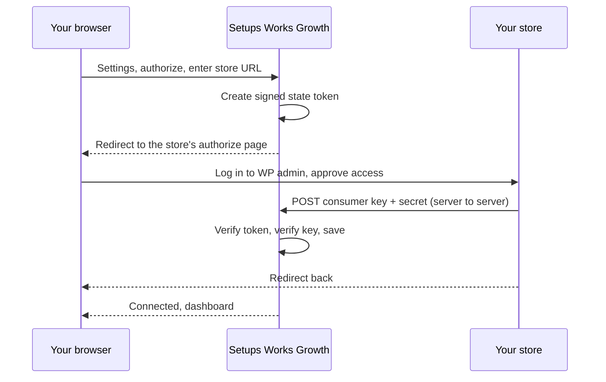

### The one requirement

That **server-to-server POST** means this app must be on a **public HTTPS
address**:

| Requirement | Why |
|---|---|
| HTTPS | WooCommerce refuses to hand credentials to a plain-HTTP callback. |
| Publicly resolvable | `localhost` points your store's server at itself, not at you. |

Both are validated **before** you are redirected, so you can never get stuck
approving an app that could not have received the result.

### Local development

```bash
docker compose up -d db                 # just the database
npm install
DATABASE_URL=postgres://growth:<POSTGRES_PASSWORD>@localhost:5432/growth npm run db:migrate
npm run dev
```

(Uncomment the `ports` line under `db` in `docker-compose.yml` to reach it from
the host.) To connect a real store locally, expose the app over HTTPS with a
tunnel — `cloudflared tunnel --url http://localhost:3000` or
`ngrok http 3000` — and set `APP_URL` to the tunnel address.

---

## WhatsApp campaigns

WhatsApp is **built in**. Each account links its own number as a **linked
device** — exactly like WhatsApp Web — by scanning a QR code in the product.
There is no gateway to deploy and no API key to paste.

Under the hood the app itself holds one session per account over the
WhatsApp Web multi-device protocol
([Baileys](https://github.com/WhiskeySockets/Baileys)) — see
[`src/lib/whatsapp/engine`](src/lib/whatsapp/engine). There is no separate
WhatsApp service. Pairings live in the `app-data` volume, and the server
reconnects every linked number when it starts, so restarts and redeploys never
need a new scan. Set `WHATSAPP_DISABLED=true` to turn WhatsApp off.

Run **one** app instance: the WhatsApp connections live in that process, and
two instances would fight over the same number.

### Safe sending (protecting your number from bans)

Every message from every feature goes through one queue per number
([`src/lib/whatsapp/engine/guard.ts`](src/lib/whatsapp/engine/guard.ts)):

| Protection | What it does |
|---|---|
| One queue, with priority | Nothing bursts. Inbox and menu replies go first, then order confirmations and checkout reminders, then campaigns and flows. |
| Human-like pacing | Random gaps between messages, a "typing…" indicator before each, and a 1–3 minute break every 15–25 marketing messages. |
| Marketing limits + warm-up | Campaigns and flows stop at a per-day and per-hour limit (Settings → WhatsApp). A newly linked number starts at 30/day and rises to your limit over ~30 days. Transactional messages and replies are never capped. |
| Quiet hours | No campaigns or flows at night (default 21:00–09:00, `WHATSAPP_TIMEZONE`). |
| Only real WhatsApp numbers | Each number is checked first; numbers not on WhatsApp are skipped. |
| Message variation | Write `{Hi|Hello|Hey}` and each customer gets one at random, so a campaign isn't 500 identical texts. |
| STOP / START | "Reply STOP to unsubscribe" is added to marketing; a STOP reply unsubscribes automatically, START re-subscribes. |
| Automatic brake | 5 marketing failures in a row pause marketing for 30 minutes. |

A campaign that reaches the limit or quiet hours waits and continues by
itself, and the campaign page says why. **This lowers the risk; it cannot
remove it** — WhatsApp decides, and being reported as spam matters most, so
only message customers who expect to hear from you.

### Linking a number

1. Open **Settings → WhatsApp** and click **Link a number**.
2. On the phone: **WhatsApp → Settings → Linked devices → Link a device**.
3. Scan the QR. It refreshes by itself; the card switches to **Linked** within
   a few seconds of the scan.
4. Confirm the default country code and the pace between messages.

**Unlink number** logs the device out of WhatsApp (it disappears from the
phone's Linked devices list) and deletes the session's local data. Unlinking
from the phone works too — the app notices and asks for a new scan.

> **Use a dedicated number.** Linked-device automation is not Meta's official
> Business API. Sending marketing at volume from a linked device can get a
> number restricted — keep the pace conservative and only message customers
> who expect to hear from you.

### Sending

On **Campaigns**, build an audience, then compose below it. The order of the
controls is the safety model:

1. **Check who this would reach** — a dry run. Resolves the real list and sends
   nothing, reporting how many were dropped and why, a masked sample, and the
   message as the first real recipient would see it.
2. **Test** — one message to a number you type. It cannot reach a customer.
3. **Send broadcast** — requires typing the deliverable count. The server
   re-resolves the audience and refuses if it changed.

### Templates and variables

Nine templates, each resolving against the customer's own history. Variables:
`{{name}}`, `{{product}}`, `{{product_url}}`, `{{category}}`, `{{last_order}}`,
`{{orders}}`, `{{spend}}`, `{{store}}`, `{{coupon}}`, `{{coupon_value}}`.

The product chosen is the one they have **spent the most on**, not the most
recent — a one-off small purchase should not become the thing a reorder message
is built around. A variable with no value is removed and the sentence tidied, so
nobody receives a literal `{{product}}` or a dangling comma.

A **campaign product** picked from the catalogue overrides that for everyone,
and supplies the photo.

### Choosing who receives it

Three ways, on the Campaigns page:

| Mode | Who it reaches |
|---|---|
| **Current filters** | Whatever the audience builder above resolves to |
| **Everyone** | Every customer in the selected date range |
| **Choose customers** | A specific list you tick, searchable by name or email |

**"Everyone" drops the filters deliberately** rather than reusing whatever is on
screen — sending to all customers should not quietly inherit a churn-risk filter
somebody set ten minutes earlier.

A chosen list **narrows** the current filter rather than replacing it, so
somebody unreachable or opted out is still excluded. Selections travel as
customer **keys**, never phone numbers: a key only means anything against the
connected store's own data, the server still resolves the number itself, and the
opt-out list is applied afterwards regardless.

### Templates

Ten, each written for a specific job rather than as a blank box:

| Template | What it says | When to send it |
|---|---|---|
| Reorder | Names the product they bought, links to it | Their usual reorder gap has passed |
| Category arrivals | New items in the range they already shop | You add stock to a category |
| Win back | References their product and last order date | At Risk or Hibernating segments |
| Second order | Asks how they got on, invites a repeat | One-time buyers, still recent |
| VIP thank you | Names their order count, invites a reply | Champions and top-tier customers |
| Review request | Asks for feedback on what they buy | Repeat customers with a recent order |
| Coupon + product | A discount tied to their own product | Lapsed customers worth converting |
| Coupon only | A store-wide discount offer | Any audience, no clear favourite |
| Announce one product | Its photo, your caption, and the buy link | A launch, a restock, a push on one item |
| Announcement | Your own words, greeting still personal | Anything else |

Templates are edited freely before sending. No approval process applies, unlike
Meta's official API.

### Variables

Each resolves per recipient, at the moment of sending:

| Variable | Resolves to |
|---|---|
| `{{name}}` | First name, or nothing for a guest checkout with no usable name |
| `{{product}}` | The product they have **spent the most on** |
| `{{product_url}}` | That product's permalink from WooCommerce |
| `{{product_image}}` | That product's first image |
| `{{category}}` | The category that product belongs to |
| `{{last_order}}` | When they last ordered, e.g. "14 March" |
| `{{orders}}` | How many orders they have placed |
| `{{spend}}` | What they have spent in total, formatted in the store's currency |
| `{{store}}` | Your store name |
| `{{coupon}}` | The coupon code attached to the campaign |
| `{{coupon_value}}` | What it is worth, e.g. "10% off" or "₹150 off" |

**Spent-the-most-on, not most-recent.** A one-off small purchase should not
become the thing a reorder message is built around.

**Unresolved variables collapse.** A variable with no value for someone is
removed and the sentence tidied afterwards — `[^\S\n]{2,}` to a single space,
` ,` to `,`, a line left as a bare colon deleted — so nobody receives a literal
`{{product}}`, a dangling comma, or a label with nothing under it.

### Sending mechanics

| | |
|---|---|
| Spacing | ~4s between messages, plus the engine's own 0–2s jitter |
| Batch size | 100 recipients per submission (the engine's maximum) |
| Duration | A full base runs for hours, deliberately |
| Interruption | Closing the page pauses; reopening resumes from the cursor |
| Engine restart | Detected and recovered automatically, costing one batch of delay |

Every excluded recipient is counted and categorised — no phone on file, an
unreadable number, a duplicate shared with another record, or an opt-out — so
"sent 9,800 of 11,000" always has an explanation.

Pacing is the point. Sending thousands of messages in minutes is the single most
reliable way to have a number restricted.

### Coupons

Pick an existing WooCommerce coupon, or generate one: a code, percentage or
fixed amount, an expiry, one use per customer, and — when a campaign product is
chosen — restricted to that product. Generated codes avoid `O`/`0` and `I`/`1`,
because they get read off a phone screen and typed at a checkout.

Codes that have expired or hit their usage limit are listed but cannot be
selected. Sending a code that will be refused is worse than sending none.

### Phone numbers

Checkout fields are free text, and numbers often carry no country code. The
**default country code** decides what a bare national number becomes, which
makes it the single setting most worth checking — a wrong value sends to the
wrong country.

Anything unreadable as a subscriber number is **dropped and counted**, never
guessed. Duplicates across customer records are collapsed so a household is
messaged once. Numbers never reach the browser.

### Buttons, product cards and link previews

A linked device cannot send tappable **buttons** or **product cards**.
Those need pre-approved templates on Meta's Cloud API; WhatsApp withdrew them
from unofficial clients.

The closest thing is WhatsApp's **link preview**, a tappable card built from the
page itself. Two things affect it:

- **Do not attach a photo** — media suppresses the preview.
- **Your product pages need `og:image`** — most WordPress SEO plugins add it.

> **Use a dedicated number.** The linked-device protocol is not
> Meta's official Business API, so there is a real risk of restriction and no
> appeal path. Do not link the number your business runs on. Messaging your own
> past customers is the safest workload; cold-blasting strangers is what gets
> numbers banned.

---

## Automated flows

A broadcast is one message to a list, now. A flow is a sequence that runs itself
over days. Build one at `/flows`.

```
entry audience  ->  step 1  --wait 3 days-->  step 2  --wait 7 days-->  step 3
                      |                         |                         |
                      +-------------------------+-------------------------+
                                        |
                              exits the moment they order
```

**Customers join as they qualify.** The entry filter is re-evaluated every run,
so someone who lapses next month enters next month. A flow keeps working rather
than sending once to whoever matched on the day it was built. Nobody enters twice
for the life of the flow — every enrolled key is remembered.

**They leave the moment it works.** With `exitOn: "ordered"`, a customer whose
order count rises above what it was when they joined stops receiving the rest.
Compared against the count at entry rather than a date, so there is no timezone
or snapshot-lag question to get wrong.

**Flows are created as drafts.** Designing a sequence and starting to send it to
thousands of people are two decisions.

**Steps and the entry filter are immutable once created.** People are already
part-way through; changing step 3 under someone who has had steps 1 and 2 gives
them a sequence nobody designed. Build a new flow instead.

### Testing a flow without touching a customer

Set a test number on a flow and it ignores its entry audience entirely — every
step goes to that one number. It is stored on the flow rather than being a
runtime toggle, so a sequence built as a test cannot later be started against an
audience by accident, and the list badges it as a test flow.

The opt-out list still applies, and a number that cannot be parsed yields no
recipient at all: a mistyped test sends nothing rather than sending somewhere
unintended.

### Scheduling

All scheduled work runs in the **`cron` service** — a BusyBox `crond` container
that POSTs to the app over the private Docker network with `CRON_SECRET` as a
bearer token. The schedule lives in [`docker/cron/crontab`](docker/cron/crontab):

| Job | Schedule (UTC) | Route |
|---|---|---|
| Sync every connected store | every 10 minutes | `/api/cron/sync` |
| Advance flows | daily at 04:30 | `/api/cron/flows` |
| Abandoned-checkout recovery | every 5 minutes | `/api/cron/abandoned-checkouts` |

Advancing flows daily means `waitDays` is the real granularity a flow gets: a
step goes out on the first run after it comes due. Change a schedule by
editing the crontab and running `docker compose up -d --build cron`. With
`CRON_SECRET` unset the routes return 503 and nothing advances.

---

## Abandoned checkout recovery

WooCommerce creates a real order — status `pending`, `on-hold` or `failed` —
the instant someone starts checkout, before payment finishes. There is no
"cart" resource in WooCommerce's REST API, so that order is the earliest
signal reachable from outside WordPress, and it already carries everything a
reminder needs. Turn it on at `/abandoned-checkouts`.

Checked every 5 minutes, live against WooCommerce rather than the cached
snapshot — the regular sync runs every 10 minutes and is close, but this
reads directly so a 30-minute window is never at the mercy of sync timing.
Only stores that turned the toggle on are ever polled.

An order becomes eligible once it has sat pending for 30 minutes, and stops
being reconsidered after 24 hours. Turning the toggle on starts a boundary at
that exact moment (`abandoned_checkout_enabled_at`): only orders placed after
are ever considered, so an existing backlog of old pending orders is never
messaged as a batch the instant the switch flips. Every order is reminded at
most once — the opt-out list and an unreadable phone number both produce a
skip, not a send, recorded in the same ledger.

---

## The menu bot

The WhatsApp engine answers inbound messages itself — around the clock, whether
or not anyone has the app open. Configure it under **Auto-reply**; it runs on the
account's linked number.

### How it answers

```
customer sends "hi"
        |
        v
  1  Order        ->  shop link, order tracking
  2  Contact us   ->  how to reach a person
  3  Feedback     ->  invitation to just type it
```

Menus nest up to three deep. Position is per conversation and expires after 15
minutes, so a stray `1` the next day is never read as a menu choice. Anything
that is neither the trigger nor a menu choice is left alone for a person to
answer in the inbox.

**Set a trigger word.** The match is exact and case-insensitive, so `hi` opens
the menu while `this` and `hi there` are ignored. Left empty, the trigger
matches *any* text message, which on a real business line means every customer
gets a menu instead of a person.

### What linked devices cannot do

No tappable buttons and no product cards — those are Meta Business API
features. A menu is numbers typed as text, and a flow branches on free text
rather than tapped replies. For official delivery, see the WhatsApp Cloud API
pilot.

---

## The assistant

`/assistant` answers questions about the store and drafts messages, through Groq.
The interesting part is not that it can read things; it is what it is prevented
from doing.

```
you ask ──► model ──► read tool  ──► executed at once, result fed back, loop continues
                 └──► action tool ──► NOT executed
                                       │
                                       ▼
                              proposal card in the UI
                                       │
                                  you approve
                                       │
                                       ▼
                          the ordinary REST endpoint,
                          with the guards it already has
```

**It reads freely.** KPIs, segments, top customers, products, stock risk,
audience sizes, flows, the menu bot, WhatsApp status — all through the same
functions the screens use, so it cannot quote a figure the dashboard disagrees
with.

**It proposes; it never performs.** Sending a test message, toggling the menu
bot, starting or pausing a flow, rewriting the menu. Each returns to the browser
as a card. Approving calls the endpoint the matching screen calls — the
assistant is a route to those endpoints, not a way around them.

**There is no broadcast tool.** Deliberately, and there is a test asserting it
stays that way. Sending to an audience is the one action that reaches thousands
of people irreversibly, and no phrasing of a prompt should get near it. It starts
from Campaigns, by a person, behind a typed confirmation.

**Phone numbers and email addresses are in nothing it can read.** The rest of the
app keeps them server-side; handing them to a model that then writes them into a
reply would be the one place that rule quietly stopped holding.

### What it can propose

A test message to a number you type · a message to one named customer · a message
to a list of customers it has just read for you, every recipient named on the
card · turning the auto-reply menu on or off · rewriting that menu · starting or
pausing a flow · generating a **PDF, Excel or CSV report** over any date range.

Approving a customer send resolves the recipients server-side and uses the count
from the platform's own dry run, not from how many names the model listed — so
unreachable and opted-out customers are excluded exactly as on the campaigns
screen. Batches are capped at 25.

### Conversations

Listed beside the chat, reopenable, deletable, and kept in `localStorage` rather
than on the server: they hold the operator's questions about their own store and
nothing the server needs, so there is no second copy of business data to secure.
The cost is that history does not follow you to another machine.

### Summaries on the analytics pages

Dashboard, customers, products, inventory, acquisition and forecast each carry a
plain-English read of what is on screen, answered through these same tools so a
summary cannot disagree with the figures above it.

It runs **on a button, not on page load**. Every summary is a model call against
a metered key with a daily cap; a dashboard that spends quota each time somebody
glances at it exhausts the allowance by mid-morning, and the assistant is then
unavailable exactly when it is wanted.

### Choosing a model, and staying inside the free tier

`openai/gpt-oss-120b` by default, `GROQ_MODEL` to override, falling back to
`llama-3.3-70b-versatile` when a daily cap is hit — the response reports which
model answered, so nobody wonders why quality moved.

Not a Llama model by default, and the reason is tool calling rather than prose:
with sixteen tools in play the Llama models intermittently emit their *text* call
format, `<function=find_product{…}</function>`, which Groq rejects outright.
gpt-oss produced a clean call every time under the same load.

Three things keep a question inside the free tier's per-minute token budget:

| | |
|---|---|
| **Action tools are sent only when wanted** | Most questions are analytics and can never need one. An analytics question carries nine schemas instead of sixteen. |
| **Tool results are truncated** | To 1,600 characters, and the truncation is announced so the model does not quote a total from a partial list. |
| **Optional parameters accept `null`** | Models say "not narrowing this" with `null` far more often than by omitting a key, and Groq validates the call before we see it. Widened via `type`, never `anyOf` — unions made the model fail to produce a call at all. |

Temperature `0.2`: this answers questions about a real business from real figures,
and inventiveness is not wanted. Without `GROQ_API_KEY` the route returns 503 and
the screen says it is unavailable.

Built with `@tanstack/ai` and the shadcn `bubble`, `message`, `message-scroller`,
`marker` and `attachment` components.

---

## Multiple stores

Authorize as many as you like. Each keeps its own credentials, data window and
snapshot cache. Switch from the sidebar or Settings; re-authorizing a store you
already have updates its key in place rather than duplicating it. Switching is a
pointer change — the next request reads a different cache rather than re-pulling.

---

## Accounts and sign-in

Accounts are email + password, stored in the app's own `users` table:

- Passwords are hashed with **scrypt** (Node's standard library — no native
  dependency). Minimum 8 characters.
- A session is an **HMAC-SHA256-signed cookie** (`AUTH_SECRET`), verified in
  `src/proxy.ts` on every request without a database round trip. 30-day lifetime.
- Sign-in, sign-up and password reset are **rate limited** per IP and per email.
- **Forgot password** emails a one-time link valid for an hour; only a SHA-256
  digest of the token is stored. Without `SMTP_*` configured, the link is
  written to the app log instead (`docker compose logs app | grep reset-password`).
- Set `DISABLE_SIGNUPS=true` to close registration on a private deployment.
- API keys (`sw_live_…`, Settings → API keys) authenticate scripts against the
  same REST API with read/write scopes.

---

## Environment variables

All configuration lives in `.env` (copy [`.env.example`](.env.example)).

| Variable | Required | Purpose |
|---|:---:|---|
| `POSTGRES_PASSWORD` | **yes** | Password for the bundled PostgreSQL container. |
| `AUTH_SECRET` | **yes** | Signs session cookies and the WooCommerce state token. |
| `CRON_SECRET` | **yes** | Authenticates the `cron` container to `/api/cron/*`. |
| `APP_URL` | to connect | Public HTTPS address WooCommerce delivers credentials to. |
| `DOMAIN` | for HTTPS | Domain for the optional Caddy service (`--profile https`). |
| `DATABASE_URL` | no | Set only to use an external database (assembled by compose otherwise). |
| `DISABLE_SIGNUPS` | no | `true` closes registration. |
| `SMTP_HOST` / `_PORT` / `_USER` / `_PASSWORD` / `_FROM` | no | Outgoing email for password resets. |
| `SNAPSHOT_CACHE_MINUTES` | no | How long a snapshot stays warm in memory. Default `10`. |
| `WHATSAPP_DISABLED` | no | `true` turns the built-in WhatsApp off for every account. |
| `WHATSAPP_DIAL_CODE` | no | Default country code for new accounts, e.g. `91`. |
| `WHATSAPP_SEND_DELAY_MS` | no | Default pause between messages. Default `4000`; floor `1000`. |
| `RAZORPAY_*` | no | Paid plans (UPI Autopay subscriptions). Unset = billing off: every account gets every feature, unlimited. |
| `GROQ_API_KEY` | for the assistant | Enables `/assistant`. Unset returns 503 and the screen says so. |

`NEXT_PUBLIC_SITE_URL` and `NEXT_PUBLIC_RAZORPAY_KEY_ID` are baked into the
browser bundle at build time — rebuild (`docker compose up -d --build`) after
changing them. WooCommerce credentials are **never** environment variables —
they arrive only through the authorization flow.

---

## Reports and exports

Ten report types, as **Excel** (formatted sheets, cover page, auto-filters),
**PDF** (branded cover, embedded font so `₹` renders), or **CSV** (bare numbers,
parseable dates, BOM-prefixed, formula-injection guarded).

Exports use the date range on screen, so a downloaded report can never silently
disagree with the dashboard it came from, and are never row-capped except in PDF,
which prints the columns that fit a page and says so.

---

## How the metrics are defined

**Net revenue** — order total less tax, shipping and refunds, for orders in
`completed`, `processing` or `on-hold`. Cancelled, failed and pending are
excluded from revenue but counted in cancellation rates.

**Customer identity** — guest checkouts carry no customer ID, so buyers are keyed
on billing email. Someone using two addresses appears twice.

**Two different repeat rates**, reported separately: *returning customer rate*
(active in the period, bought before it) and *repeat rate in period* (bought more
than once inside it). On a 30-day window these differ by an order of magnitude.

**New and returning lists overlap by design.** A customer acquired in the period
who buys again is genuinely both.

**RFM scores** are quintiles within your own base, not absolute thresholds.

**Predicted CLV** projects the observed order rate twelve months forward,
discounted by churn risk. It is an estimate, and the UI says so.

**Days of cover** is stock divided by units sold per day over the range.

**Order Attribution** is core WooCommerce from 8.5; earlier orders carry none,
and the coverage percentage is reported rather than hidden.

---

## Performance

Against a production store of roughly **20,000 orders and 11,000 customers**:

| Measure | Result |
|---|---|
| Cold instance, empty memory and disk | 3.5 s |
| Warm request | 0.7 s |
| Deployed production request | ~2 s |
| Full-year customer payload, on the wire | 911 KB |
| Cached snapshot | 2.0 MB gzipped |

**Payload trimming.** `_fields` does not reach nested arrays, so every line item
arrived carrying its tax breakdown, `meta_data` and a full image object.
Removing what the engine never reads cut the payload **81%**.

**Shared caching.** The snapshot is cached where every instance can see it,
gzipped and chunked behind a manifest, chunks written before the manifest so a
reader never sees a partial set. A per-instance cache meant each cold start
re-pulled the whole history — slow, and enough traffic that the store's security
layer began refusing requests.

**Order history on demand.** Customer records ship without their orders, which is
half a record's weight. That is what lets the ledger list every customer.

**Paced fetching.** Orders paginate three connections wide with a pause between
batches. Transient failures retry with exponential backoff.

---

## Design system

Black, white and one blue — `#2f66e8`, converted to oklch to match the rest of
the tokens. A single accent means anything blue is deliberate: a link, a primary
action, a selected row, never decoration. Dark mode uses a lighter step of the
same hue, because `#2f66e8` on near-black does not carry enough contrast for text
sitting on it.

Chrome is monochrome by intent, so colour is reserved for data and genuine state.
Charts use an eight-slot categorical palette validated for colour-vision
deficiency separation, a normal-vision distinctness floor, lightness banding and
contrast — in **both** modes, with dark steps selected for the dark surface
rather than flipped.

- **No dual-axis charts.** Two measures sharing a plot share one scale.
- **Sequential ramps are single-hue**; diverging pairs use a neutral midpoint.
- **Legends always present for two or more series**, so identity is never colour
  alone. Status colours ship with an icon and a label.
- **Unelapsed cohort cells are blank**, not zero.
- Geist and Geist Mono, tabular figures in columns that must align.

---

## Deployment

The same `docker compose` stack runs anywhere Docker does.

### Azure (student account)

The simplest fit for Azure for Students is a single **Linux VM** (a B1s or
B2s is enough) running the whole stack:

1. Create an Ubuntu VM. In its network security group, allow inbound **22**,
   **80** and **443**.
2. Point a domain's DNS **A record** at the VM's public IP. (No domain? Azure
   gives the VM a free `<name>.<region>.cloudapp.azure.com` DNS label under
   *Public IP → Configuration*.)
3. On the VM:
   ```bash
   curl -fsSL https://get.docker.com | sh
   git clone <your-repo-url> growth && cd growth
   cp .env.example .env
   # fill in POSTGRES_PASSWORD, AUTH_SECRET, CRON_SECRET,
   # DOMAIN=your.domain and APP_URL=https://your.domain
   sudo docker compose --profile https up -d --build
   ```
4. Caddy obtains a Let's Encrypt certificate automatically. Open
   `https://your.domain`, sign up, and connect your store.

Updating: `git pull && sudo docker compose --profile https up -d --build`.
Backing up: `sudo docker compose exec db pg_dump -U growth growth > backup.sql`.

**Managed alternatives.** The app image also runs on Azure Container Apps or
App Service for Containers, with Azure Database for PostgreSQL
(`DATABASE_URL=...?sslmode=require`). The scheduler then needs a replacement —
e.g. a Container Apps *scheduled job* that runs the same `wget` calls as
[`docker/cron/crontab`](docker/cron/crontab). Run one app replica, or accept
that the in-memory rate limiter and snapshot memo are per replica.

**WhatsApp** runs inside the app, which therefore needs to stay up as a single
instance with a persistent volume at `/app/.data` — on the VM setup it does.
On Container Apps, set min and max replicas to 1 and mount an Azure Files
share at `/app/.data`.

---

## Troubleshooting

**"Your store cannot reach this app"** — `APP_URL` points at localhost or a
private address. The callback is a server-to-server POST. Use a tunnel.

**"This deployment cannot save a connection"** — `DATABASE_URL` is missing or
the database is unreachable. Check `docker compose ps` and `docker compose logs db`.

**Didn't receive a password-reset email** — SMTP isn't configured; the link is in
`docker compose logs app`.

**"AUTH_SECRET is not set"** — generate one with `openssl rand -hex 32`.

**"WooCommerce never delivered the key"** — check `APP_URL` is publicly reachable
and nothing (WAF, firewall, basic auth) blocks the POST.

**REST API returns 404** — WordPress permalinks are "Plain".

**"The store key is read-only"** on coupon creation — the key predates the scope
change. Reconnect the store in Settings to re-approve it.

**WhatsApp keeps asking for a new QR** — the `app-data` volume is not being
persisted, or the device was unlinked from the phone. Check `docker compose logs app | grep whatsapp`.

**"The session cannot send right now"** — status and engine disagree, which
happens after an engine restart. The app restarts the engine automatically; if it
persists, the pairing itself is gone and the QR needs re-scanning.

**Everyone dropped as "unreadable"** — the default country code is empty or wrong.

**No attribution data** — WooCommerce below 8.5, or Order Attribution disabled.

**Inventory page empty** — stock management is not enabled on the products.

---

## Scripts

```bash
docker compose up -d --build   # build and start the whole stack
docker compose logs -f app     # follow app logs
npm run dev                    # development server (needs DATABASE_URL)
npm run db:migrate             # apply db/migrations/*.sql
npm run build                  # production build
npm run lint                   # eslint
npm run typecheck              # tsc --noEmit
npm test                       # Playwright end-to-end suite
BASE_URL=https://your.domain npm run test:smoke   # check a live deployment
```

### Database migrations

The schema lives in [`db/migrations`](db/migrations), applied in filename order
by [`scripts/migrate.mjs`](scripts/migrate.mjs) — automatically on every app
container start, each file once, inside a transaction, under an advisory lock.
To change the schema, add the next numbered file (e.g. `0002_add_x.sql`); never
edit one that has been applied.

### Tests

The suite runs against a production build with **no store connected and no
WhatsApp engine configured** — the state a fresh clone is in. Nothing touches a real
store or sends a message. It asserts that every endpoint refuses work it
cannot do (a missing store is a `409`, not a crash), that the audience schema
exposes no way to pass phone numbers directly, and that every route in
`src/app/api` appears in the OpenAPI document.

### API reference

The API is described by an OpenAPI 3.1 document at **`/api/openapi`** and
rendered as Swagger UI at **`/api-docs`**, served from the bundle rather than a
CDN so the reference works behind a firewall and is pinned to the version in
the lockfile. "Try it out" is disabled: every route either needs a connected
store or changes real state, and a docs page is no place to fire a live
broadcast. It is written by hand rather than generated: these are
Next.js handlers with Zod validation inside them, which no generator reads
faithfully, and a generated document that drifts is worse than one somebody
keeps honest. CI fails if a route exists that the document does not describe.

### Continuous integration

[`.github/workflows/ci.yml`](.github/workflows/ci.yml) runs on every push and
pull request: typecheck, lint, the API-documentation coverage check, a Docker
image build, and the end-to-end suite against a throwaway PostgreSQL service.

Smoke-test any running deployment:

```bash
BASE_URL=https://your.domain npx playwright test --project=smoke
```

---

<div align="center">

<br/>

Built by

<picture>
  <source media="(prefers-color-scheme: dark)" srcset="public/brand/setups-works-white.png">
  <source media="(prefers-color-scheme: light)" srcset="public/brand/setups-works-black.png">
  
</picture>

<br/>

[setups.works](https://setups.works)
nitheesh rajendran

<sub>Self-hosted · your data and your WhatsApp number stay on your infrastructure</sub>

<sub>Licensed under the <a href="https://opensource.org/licenses/MIT">MIT License</a></sub>

</div>
